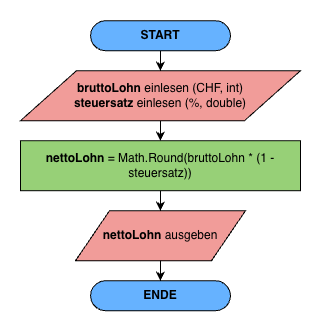
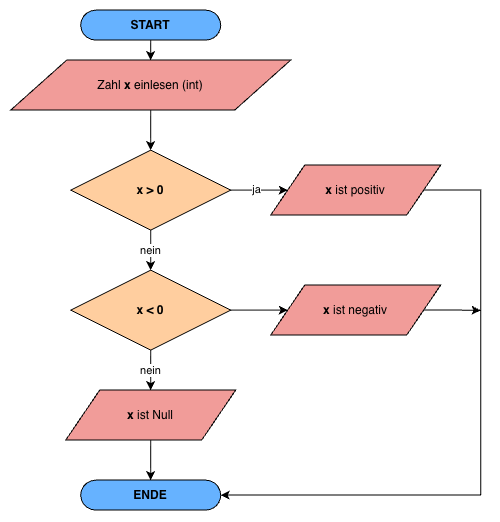
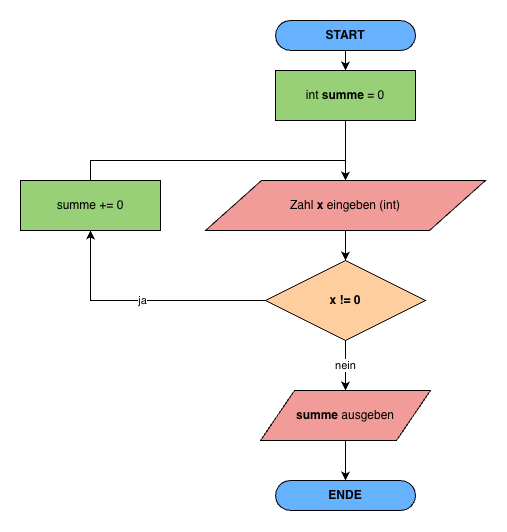

# Lösungen

## Variablen & Datentypen

### Aufgabe 1

```csharp
int x = 5;
double y = 5.67;
string name = "Linda";

Console.WriteLine(x.GetType());
Console.WriteLine(y.GetType());
Console.WriteLine(name.GetType());

// System.Int32
// System.Double
// System.String

```

---

### Aufgabe 2

```csharp
Console.Write("Wie heisst du?: ");
string name = Console.ReadLine();
Console.WriteLine($"Hallo {name}! Schön, dass es dich gibt.");
```

---

### Aufgabe 3

Die Variable `alter` wird in der 2. Zeile als String deklariert. In der dritten Zeile versucht man jedoch mit dieser Variable zu rechnen, was zu einem Konvertierungs-Fehler führt:

`Cannot implicitly convert type 'string' to 'int'`

---

### Aufgabe 4

#### 4.1

```csharp
Console.Write("Wie heisst du?: ");
string name = Console.ReadLine();
Console.WriteLine(name.ToUpper()); // LARS
Console.WriteLine(name.ToLower()); // lars
```

#### 4.2

```csharp
Console.Write("Gib ein Wort ein: ");
string firstWord = Console.ReadLine();
Console.Write("Gib ein zweites Wort ein: ");
string secondWord = Console.ReadLine();
Console.WriteLine($"{firstWord}{secondWord}");
```

---

### Aufgabe 5



---

## Rechnen

### Aufgabe 1

`2 // Bei der Integer-Divsion wird der Nachkommateil abgeschnitten.`

---

### Aufgabe 2

```csharp
// Zwei Zahlen einlesen
Console.WriteLine("Bitte gib zwei beliebige Zahlen ein:");
Console.Write("Zahl 1: ");
decimal zahl1 = decimal.Parse(Console.ReadLine());
Console.Write("Zahl 2: ");
decimal zahl2 = decimal.Parse(Console.ReadLine());

// Mathematische Operationen
decimal resultatAddition = Math.Round(zahl1 + zahl2, 2);
decimal resultatSubtraktion = Math.Round(zahl1 - zahl2, 2);
decimal resultatMultiplikation = Math.Round(zahl1 * zahl2, 2);
decimal resultatDivision = Math.Round(zahl1 / zahl2, 2);

// Ausgabe der Resultate
Console.WriteLine($"{zahl1} + {zahl2} = {resultatAddition}");
Console.WriteLine($"{zahl1} - {zahl2} = {resultatSubtraktion}");
Console.WriteLine($"{zahl1} * {zahl2} = {resultatMultiplikation}");
Console.WriteLine($"{zahl1} / {zahl2} = {resultatDivision}");
```

Werden zwei int-Werte dividiert, findet eine **Ganzzahldivision** statt. Das Ergebnis ist ebenfalls ein int; der Nachkommateil wird abgeschnitten. Ist mindestens ein Operand vom Typ decimal, findet eine **Dezimaldivision** statt und das Ergebnis ist ein decimal.

---

### Aufgabe 3

```csharp
int x = 5;
x++;
Console.WriteLine(x);
x--;
x--;
Console.WriteLine(x);
```

---

### Aufgabe 4 - Schokoriegel 🍫

```csharp
decimal preis = 3.20m;
decimal budget = 20.00m;

int anzahl = (int)(budget / preis); // Cast führt dazu, dass Nachkommastelle abgeschnitten wird
decimal rest = budget % preis; // Alternativ ohne Modulo: decimal rest = budget - (anzahl * preis);

Console.WriteLine($"Anzahl Riegel: {anzahl}");
Console.WriteLine($"Restbetrag: {rest:F2} Franken"); // rest:F2 rundet auf zwei Stellen nach dem Komma
```

---

### Aufgabe 5 - Streaming-Rechner 🖥️

```csharp
// Begrüssung
Console.WriteLine("=== Streaming-Rechner ===");
Console.WriteLine("Dieses Programm berechnet, wie viele Stunden du mit deinem Datenvolumen streamen kannst.");
Console.WriteLine();

// Eingaben mit Konvertierung
Console.Write("Wie viel Datenvolumen hast du noch (in GB)? ");
double datenvolumenGB = double.Parse(Console.ReadLine());

Console.Write("Wie viele MB braucht eine Stunde Video? ");
int verbrauchProStundeMB = int.Parse(Console.ReadLine());

// Berechnungen
const int MB_PRO_GB = 1000;
double datenvolumenMB = datenvolumenGB * MB_PRO_GB;
int anzahlStunden = (int)(datenvolumenMB / verbrauchProStundeMB);
double restMB = datenvolumenMB - anzahlStunden * verbrauchProStundeMB;

// Zusatzaufgaben
double restMinuten = restMB / verbrauchProStundeMB * 60;
double restGB = restMB / MB_PRO_GB;

// Ausgabe
Console.WriteLine();
Console.WriteLine($"Dein Datenvolumen: {datenvolumenMB} MB");
Console.WriteLine($"Ganze Stunden Streaming: {anzahlStunden} h");
Console.WriteLine($"Restvolumen: {restMB} MB");
Console.WriteLine($"Damit reicht es noch für {restMinuten:F0} Minuten Video.");
Console.WriteLine($"Restvolumen in GB: {restGB:F2} GB");
```

---

## Bedingungen I

### Aufgabe 1 - PAP zeichnen



---

### Aufgabe 2 - Code lesen

- a) Zahl1 = 3, Zahl2 = 6
- b) Zahl1 = 5, Zahl2 = 8

---

### Aufgabe 3 - Fehler erkennen

- **Kompilierfehler Zeile 9**: if (wert1 > wert2 && > wert3) — nach && fehlt ein vollständiger boolescher Ausdruck. Korrektur: if (wert1 > wert2 && wert1 > wert3)
- **Zweiter Fehler Zeile 15**: else (wert3 > wert2) — ein else darf keine eigene Bedingung in Klammern haben. Korrektur: einfaches else (reicht hier, da nur noch zwei Fälle übrig sind)

---

### Aufgabe 4 - Ringen 🤼‍♂️

```csharp
Console.Write("Geschlecht [m/w]: ");
string geschlecht = Console.ReadLine();
Console.Write("Gewicht [in Kg]: ");
double gewicht = Convert.ToDouble(Console.ReadLine());

string klasse;
if (geschlecht == "m")
{
    if (gewicht <= 55) klasse = "Fliegengewicht";
    else if (gewicht <= 66) klasse = "Leichtgewicht";
    else if (gewicht <= 84) klasse = "Mittelgewicht";
    else klasse = "Schwergewicht";
}
else
{
    if (gewicht <= 48) klasse = "Fliegengewicht";
    else if (gewicht <= 55) klasse = "Leichtgewicht";
    else if (gewicht <= 63) klasse = "Mittelgewicht";
    else klasse = "Schwergewicht";
}
Console.WriteLine("Gewichtsklasse: " + klasse);
```

---

### Aufgabe 5 - Kino 🍿

```csharp
Console.Write("Alter: ");
int alter = int.Parse(Console.ReadLine()!);

Console.Write("Studierende/r [j/n]: ");
bool student = Console.ReadLine() == "j";

Console.Write("In Begleitung einer erwachsenen Person [j/n]: ");
bool begleitung = Console.ReadLine() == "j";

// Zutritt: ab 12 oder ab 9 mit Begleitung
bool zutritt = alter >= 12 || (alter >= 9 && begleitung);

if (!zutritt)
{
    Console.WriteLine("Kein Zutritt");
}
else
{
    int preis;

    if (alter < 12)
    {
        preis = 10;
    }
    else if ((alter >= 12 && alter <= 17) || student || alter >= 65)
    {
        preis = 13;
    }
    else
    {
        preis = 18;
    }

    Console.WriteLine($"Eintritt: CHF {preis}.–");
}
```

---

## Bedingungen II

### Aufgabe 1 - Jahreszeiten 🌼

```csharp
Console.Write("Monat [1-12]: ");
int monat = Convert.ToInt32(Console.ReadLine());

switch (monat)
{
    case 3:
    case 4:
    case 5:
        Console.WriteLine("Frühling"); break;
    case 6:
    case 7:
    case 8:
        Console.WriteLine("Sommer"); break;
    case 9:
    case 10:
    case 11:
        Console.WriteLine("Herbst"); break;
    case 12:
    case 1:
    case 2:
        Console.WriteLine("Winter"); break;
    default:
        Console.WriteLine("Ungültiger Monat"); break;
}
```

---

### Aufgabe 2 - Code lesen

anzahl ist in allen drei Fällen 2.

- a) Note1 = 4.2, Note2 = 3.5: Schnitt = 3.85 → kleiner 4, note1>=4 wahr → **Typ 1**
- b) Note1 = 5.2, Note2 = 5.8: Schnitt = 5.5 → mind. 4, durchschnitt=(int)(11.0)=11, (11+1)/2=6 → nicht 4, nicht 5 → **Typ 4**
- c) Note1 = 3.8, Note2 = 3.3: Schnitt = 3.55 → kleiner 4, beide Noten < 4 → **Typ 0**

---

### Aufgabe 3 - Wochentag ermitteln 📅

```csharp
  Console.Write("Tag: ");
  int t = Convert.ToInt32(Console.ReadLine());
  Console.Write("Monat: ");
  int m = Convert.ToInt32(Console.ReadLine());
  Console.Write("Jahr: ");
  int j = Convert.ToInt32(Console.ReadLine());

  if (m <= 2)
  {
      m += 10;
      j -= 1;
  }
  else
  {
      m -= 2;
  }

  int c = j / 100;
  j = j % 100;

  int h = (((26 * m - 2) / 10) + t + j + j / 4 + c / 4 - 2 * c) % 7;
  if (h < 0)
      h += 7;

  string wochentag;
  switch (h)
  {
      case 0: wochentag = "Sonntag"; break;
      case 1: wochentag = "Montag"; break;
      case 2: wochentag = "Dienstag"; break;
      case 3: wochentag = "Mittwoch"; break;
      case 4: wochentag = "Donnerstag"; break;
      case 5: wochentag = "Freitag"; break;
      case 6: wochentag = "Samstag"; break;
      default: wochentag = "unbekannt"; break;
  }

  Console.WriteLine("Der " + t + "." + m + "." + j + " ist ein " + wochentag);
```

---

### Aufgabe 4 - Ostersonntag 🐣

```csharp
Console.Write("Jahr: ");
int jahr = Convert.ToInt32(Console.ReadLine());

int m = (8 * (jahr / 100) + 13) / 25 - 2;
int s = jahr / 100 - jahr / 400 - 2;
m = (15 + s - m) % 30;
int n = (6 + s) % 7;

int a = jahr % 19;
int b = jahr % 4;
int c = jahr % 7;
int d = (19 * a + m) % 30;
if (d == 29)
    d = 28;
else if (d == 28 && a >= 11)
    d = 27;
int e = (2 * b + 4 * c + 6 * d + n) % 7;

int ostertag = 22 + d + e;
string monat = "März";
if (ostertag > 31)
{
    ostertag = ostertag % 31;
    monat = "April";
}

Console.WriteLine("Ostersonntag " + jahr + ": " + ostertag + ". " + monat);
```

---

## Schleifen I

### Aufgabe 1 - PAP zeichnen



---

### Aufgabe 2 - Code lesen

a)

```csharp
1
2
4
8
16
32
Ende: 64
```

b)

```csharp
a = -2, b= 22
```

---

### Aufgabe 3 - Countdown und Summe

```csharp
// Countdown von 10 bis 1
int i = 10;
while (i >= 1)
{
    Console.WriteLine(zaehler);
    i--;
}
Console.WriteLine("Start!");

// Summe von 1 bis n
Console.Write("Gib eine Zahl n ein: ");
int n = int.Parse(Console.ReadLine());

int summe = 0;
int i = 1;
while (i <= n)
{
    summe += i;
    i++;
}

Console.WriteLine($"Die Summe aller Zahlen von 1 bis {n} ist {summe}.");
```

---

### Aufgabe 4 - Fehler finden

**Fehler 1: Kompilierfehler in Zeile 02/03**

zahl wird in Zeile 03 in der Bedingung zahl != 0 gelesen, hat aber noch keinen Wert. C# verlangt, dass lokale Variablen vor dem ersten Lesen zugewiesen sind, sonst bricht der Compiler mit CS0165: Verwendung der nicht zugewiesenen lokalen Variablen „zahl“ ab.

F**ehler 2: Logikfehler in Zeile 07**

summe =+ zahl; ist kein Additionsoperator, sondern wird als summe = +zahl; gelesen (Zuweisung mit unärem Plus). summe wird also bei jedem Durchlauf mit der aktuellen Zahl überschrieben. Da die letzte Eingabe immer 0 ist, gibt das Programm stets Summe: 0 aus. Korrekt ist der Verbundoperator +=.

---

### Aufgabe 5 - Eingabeprüfung

```csharp
int age = 0;

do
{
    Console.Write("Bitte gib dein Alter [in Jahren] ein: ");
    age = int.Parse(Console.ReadLine());

    if (age < 0 || age > 120 )
    {
        Console.WriteLine("Deine Eingabe war ungültig.");
    }
}
while (age < 0 || age > 120);

Console.WriteLine($"Gratuliere! Du bist {age} Jahre alt.");
```

---

### Aufgabe 6 - Zahlenraten 🔮

```csharp
Random zufall = new Random();
int geheim = zufall.Next(1, 101);

int tipp = 0;
int versuche = 0;

Console.WriteLine("An welche Zahl von 1 bis 100 denke ich? Versuche die Zahl in möglicht wenigen Versuchen zu erraten. Viel Glück!");


while (tipp != geheim)
{
    Console.Write("Dein Tipp: ");
    tipp = int.Parse(Console.ReadLine());

    if (tipp > geheim)
    {
        Console.WriteLine("Zu hoch.");
    }
    else if (tipp < geheim)
    {
        Console.WriteLine("Zu tief.");
    }
    versuche++;
}
Console.WriteLine($"Gratulation! Du bist ein Hellseher und hast nur {versuche} Versuche gebraucht.");
```

---

### Aufgabe 7 - Lotto 🍀

```csharp
Random zufall = new Random();
int zahl1, zahl2, zahl3, zahl4, zahl5, zahl6, glüeckszahl;

do
{
    zahl1 = zufall.Next(1, 43);
    zahl2 = zufall.Next(1, 43);
    zahl3 = zufall.Next(1, 43);
    zahl4 = zufall.Next(1, 43);
    zahl5 = zufall.Next(1, 43);
    zahl6 = zufall.Next(1, 43);
    glueckszahl = zufall.Next(1, 7);
}
while (zahl1 == zahl2 || zahl1 == zahl3 || zahl1 == zahl4 || zahl1 == zahl5 || zahl1 == zahl6 || zahl2 == zahl3 || zahl2 == zahl4 || zahl2 == zahl5 || zahl2 == zahl6 || zahl3 == zahl4 || zahl3 == zahl5 || zahl3 == zahl6 || zahl4 == zahl5 || zahl4 == zahl6 || zahl5 == zahl6);

Console.WriteLine($"Tipp: {zahl1}, {zahl2}, {zahl3}, {zahl4}, {zahl5}, {zahl6}. Glückszahl: {glueckszahl}");
```

---

### Aufgabe 8 - Josefsrappen 🪙

```csharp
int startJahr, zielJahr;
double betrag, zinssatz, goldErden;

Console.Write("Bitte gib ein Startjahr (z.B. 1934) ein: ");
startJahr = int.Parse(Console.ReadLine());

Console.Write("Bitte gib ein Zieljahr (z.B. 2045) ein: ");
zielJahr = int.Parse(Console.ReadLine());

Console.Write("Bitte gib einen Betrag in CHF ein, den du anlegen möchtest: ");
betrag = double.Parse(Console.ReadLine());

Console.Write("Bitte gib einen Zinssatz in % ein, zu dem du anlegen möchtest: ");
zinssatz = double.Parse(Console.ReadLine());

do
{
    betrag = betrag * (1 + zinssatz / 100);
    startJahr++;
}
while (startJahr < zielJahr);

Console.WriteLine($"Der Betrag im {zielJahr} beläuft sich auf CHF {betrag.ToString("E3")}.-");

double wertErde = 2.09e30;

goldErden = Math.Floor(betrag / wertErde);

Console.WriteLine($"Für diesen Betrag könntest du dir {goldErden} Erden aus purem Gold kaufen!");
```

---

<!--

## Schleifen II

### Aufgabe 1 - Code lesen

a) Die Ausgabe des Codes lautet: **1 2 4 5 7 8**

Schritt-für-Schritt-Ablauf:

Die Schleife läuft mit der Variable i von 1 bis 10. In jedem Durchlauf gelten zwei Bedingungen:

1. if (i % 3 == 0) continue; – Wenn i durch 3 teilbar ist (3, 6, 9), springt das Programm sofort zum nächsten Schleifendurchlauf.
2. if (i > 8) break; – Wenn i grösser als 8 ist (ab 9), wird die Schleife komplett abgebrochen.


b) **30**

Die Schleife startet bei i = 2 und erhöht i in jedem Schritt um 2 (i += 2). Es werden also nur die geraden Zahlen bis einschliesslich 10 addiert.


c) Die Ausgabe des Codes lautet: **25,16,9,4,1,**

Die Schleife zählt rückwärts von 5 runter bis 1 (i > 0). In jedem Durchlauf wird das Quadrat der Zahl (i * i) gefolgt von einem Komma ausgegeben

---

### Aufgabe 2 - Einmaleins

```csharp
Console.Write("Gib eine positive Ganzzahl ein: ");
int x = int.Parse(Console.ReadLine());

for (int i = 1; i <= 10; i++)
{
    Console.WriteLine($"{i} x {x} = {i*x}");
}
```

---

### Aufgabe 3 - Fakultät

```csharp
long fakultaet = 1;

Console.Write("Gib eine positive Ganzzahl ein: ");
int n = int.Parse(Console.ReadLine());

Console.Write($"{n}! = ");
for (int i = 1; i <= n; i++)
{
    if (i < n)
    {
       Console.Write($"{i} x ");
        fakultaet *= i;
        continue;
    }

    if (i == n)
    {
        fakultaet *= n;
        Console.Write($"{n} = {fakultaet}");
        break;
    }
}
```

---

### Aufgabe 4 - Sternendreieck ⭐️

```csharp
Console.Write("Gib die Anzahl der Zeilen ein: ");
int zeilen = int.Parse(Console.ReadLine());

// Äussere Schleife kontrolliert die Zeilen (von 1 bis zur eingegebenen Anzahl)
for (int i = 1; i <= zeilen; i++)
{
    // Innere Schleife druckt die Sterne für die aktuelle Zeile i
    for (int j = 1; j <= i; j++)
    {
        Console.Write("*");
    }

    // Nach den Sternen springen wir in die nächste Zeile
    Console.WriteLine();
}
```

---

### Aufgabe 5 - Einmaleins-Tabelle 🧮

```csharp
// Äussere Schleife kontrolliert die Zeilen (Faktor 1)
for (int zeile = 1; zeile <= 10; zeile++)
{
    // Innere Schleife kontrolliert die Spalten (Faktor 2)
    for (int spalte = 1; spalte <= 10; spalte++)
    {
        // Berechne das Produkt für die aktuelle Zelle
        int produkt = zeile * spalte;

        // Ausgabe des Wertes, rechtsbündig ausgerichtet auf 4 Zeichen
                Console.Write(produkt.ToString().PadLeft(4));
    }

    // Am Ende jeder Zeile springen wir in die nächste Zeile
    Console.WriteLine();
}
```

---


-->
