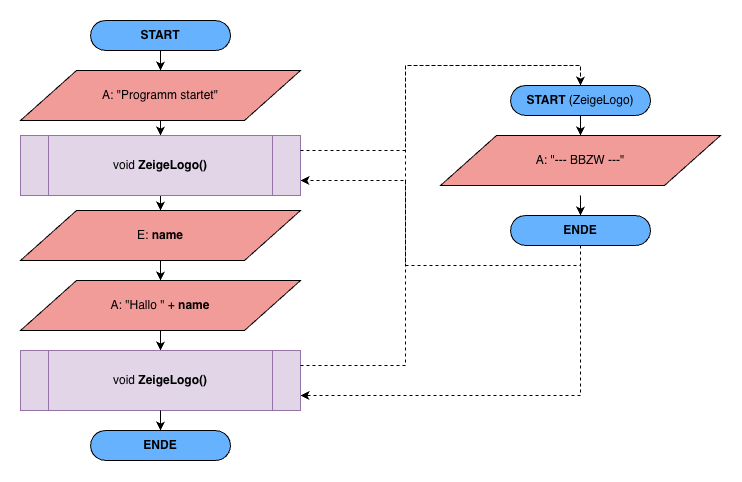

# Funktionen (1/3)

## Lernziel
Am Ende dieser Lektion definierst und rufst du Funktionen (Unterprogramme) auf, verstehst den Ablauf beim Aufruf, stellst Funktionen im PAP dar und übergibst Werte als Parameter.

---

## 1. Einstieg

- Ohne Funktionen steht derselbe Code an vielen Stellen. Eine Änderung muss dann überall nachgezogen werden, und dabei entstehen Fehler. Eine Funktion steht einmal im Programm und wird beliebig oft aufgerufen.
- Funktionen zerlegen ein grosses Programm in kleine, benannte Bausteine. Ein Programm aus Funktionen wie `ZeigeMenue()` und `ZeichneLinie()` liest sich fast wie ein Text.
- Jedes grössere Programm besteht aus Funktionen. Wer sie beherrscht, kann sich in fremdem Code zurechtfinden und eigenen Code übersichtlich halten.

---

## 2. Grundlagen

### A - Eine Funktion definieren und aufrufen

```csharp
void ZeichneLinie()
{
    Console.WriteLine("--------------------");
}
```

Aufruf:

```csharp
ZeichneLinie();
```

- `void` bedeutet: Die Funktion gibt keinen Wert zurück.
- Der Name beginnt mit einem Grossbuchstaben (PascalCase) und enthält meist ein Verb: `ZeichneLinie`, `ZeigeMenue`, `BerechneSumme`.
- Die Klammern `()` gehören zur Definition und zum Aufruf. Der Aufruf endet mit einem Semikolon.
### B - Der Ablauf beim Aufruf

```csharp
Console.WriteLine("A");     // 1
Zwei();                     // 2, springt in die Funktion
Console.WriteLine("B");     // 7

void Eins()
{
    Console.WriteLine("1"); // 4
}

void Zwei()
{
    Console.WriteLine("2"); // 3
    Eins();                 // springt in Eins
    Console.WriteLine("3"); // 5
}
```

Bei einem Aufruf springt das Programm in die Funktion, führt sie aus und kehrt danach genau an die Stelle des Aufrufs zurück. Funktionen können andere Funktionen aufrufen.

### C - Wo steht die Funktion?

- Das Hauptprogramm steht oben, die Funktionen stehen darunter.
- Das Programm wird von oben nach unten ausgeführt. Eine Funktion läuft erst, wenn sie aufgerufen wird. Die Definition allein führt nichts aus.
- Die Reihenfolge der Funktionen untereinander spielt keine Rolle.

### D - Parameter

```csharp
Begruesse("Anna");
Begruesse("Ben");

void Begruesse(string name)
{
    Console.WriteLine("Hallo " + name + "!");
}
```

Ein Parameter ist ein Platzhalter in der Definition. Beim Aufruf wird er mit einem Wert gefüllt.

**Mehrere Parameter**

```csharp
ZeichneLinie(10, "=");
ZeichneLinie(5, "*");

void ZeichneLinie(int laenge, string zeichen)
{
    for (int i = 0; i < laenge; i++)
    {
        Console.Write(zeichen);
    }
    Console.WriteLine();
}
```

Die Argumente beim Aufruf müssen in Anzahl, Reihenfolge und Datentyp zu den Parametern passen.

| Begriff | Bedeutung | Beispiel |
|---|---|---|
| Parameter | steht in der Definition | `int laenge` |
| Argument | steht beim Aufruf | `10` |

### E - Parameter sind Kopien

```csharp
int x = 5;
Verdopple(x);
Console.WriteLine(x);   // 5

void Verdopple(int zahl)
{
    zahl = zahl * 2;
}
```

Die Funktion erhält eine Kopie des Werts. Was sie mit ihrem Parameter macht, ändert die Variable ausserhalb nicht.

### F - Funktionen rufen Funktionen

```csharp
ZeichneDreieck(3);

void ZeichneDreieck(int zeilen)
{
    for (int zeile = 1; zeile <= zeilen; zeile++)
    {
        ZeichneLinie(zeile, "*");
    }
}
```

So lassen sich grosse Aufgaben in kleine Bausteine zerlegen.

### G - PAP: Das Unterprogramm

Ein Funktionenaufruf wird im PAP als **Rechteck mit doppelten senkrechten Seitenlinien** gezeichnet (Symbol "Unterprogramm"). Die Funktion selbst hat einen eigenen PAP.



---

## 3. Übungen

**Regeln**: Die offizielle C#-Dokumentation und Ressourcen im Netz darfst du verwenden. KI-Tools bleiben weg, damit der Lerneffekt möglichst gross ist.

### 1. Code lesen I
Was gibt das Programm jeweils aus?

a)
```csharp
Console.WriteLine("Start");
Gruss();
Console.WriteLine("Mitte");
Gruss();
Gruss();
Console.WriteLine("Ende");

void Gruss()
{
    Console.WriteLine("Hallo!");
}
```

b)
```csharp
Console.WriteLine("A");
Zwei();
Console.WriteLine("B");

void Eins()
{
    Console.WriteLine("1");
}

void Zwei()
{
    Console.WriteLine("2");
    Eins();
    Console.WriteLine("3");
}
```

### 2. PAP zeichnen
Zeichne den PAP für ein Programm, das zuerst die Funktion `ZeichneLinie`, dann den Text "Titel" und danach nochmals `ZeichneLinie` aufruft. Zeichne zusätzlich den PAP der Funktion `ZeichneLinie` selbst, die 20 Minuszeichen mit einer Schleife ausgibt.

### 3. Fehler finden I
Das Programm soll "Start", "Hallo!" und "Ende" ausgeben. Es enthält **zwei Fehler**, beide sind Kompilierfehler. Finde beide und korrigiere sie. Tipp: Der Compiler meldet nicht immer alle Fehler auf einmal.

```csharp
01  Console.WriteLine("Start");
02  Gruss;
03  Console.WriteLine("Ende");
04
05  void Gruss()
06  {
07      Console.WriteLine("Hallo!")
08  }
```

### 4. Menü und Linie schreiben
1. Schreibe eine Funktion `ZeigeMenue()`, die drei Zeilen ausgibt: `1) Neues Spiel`, `2) Einstellungen`, `0) Beenden`.
2. Schreibe eine Funktion `ZeichneLinie()`, die mit einer Schleife 20 Minuszeichen in einer Zeile ausgibt.
3. Das Hauptprogramm ruft `ZeichneLinie()` auf, gibt den Text "Titel" aus, ruft nochmals `ZeichneLinie()` auf und ruft danach `ZeigeMenue()` auf.
### 5. Code lesen II
Was gibt das Programm aus?

```csharp
int x = 5;
Verdopple(x);
Console.WriteLine(x);
Zeige(3, "m");
Zeige(10, "cm");

void Verdopple(int zahl)
{
    zahl = zahl * 2;
    Console.WriteLine("In der Funktion: " + zahl);
}

void Zeige(int wert, string einheit)
{
    Console.WriteLine(wert + " " + einheit);
}
```

### 6. Fehler finden II
Die Funktion `Rechteck` soll ein Rechteck aus dem angegebenen Zeichen ausgeben. Beide Aufrufe sind fehlerhaft. Finde beide Fehler, erkläre sie und korrigiere sie.

```csharp
01  Rechteck("*", 4, 2);
02  Rechteck(3, 2);
03
04  void Rechteck(int breite, int hoehe, string zeichen)
05  {
06      for (int z = 0; z < hoehe; z++)
07      {
08          for (int s = 0; s < breite; s++)
09              Console.Write(zeichen);
10          Console.WriteLine();
11      }
12  }
```

### 7. Funktionen mit Parametern schreiben
Schreibe folgende Funktionen und rufe jede im Hauptprogramm mindestens einmal auf:

1. `ZeichneLinie(int laenge, string zeichen)` gibt eine Linie in der angegebenen Länge aus dem angegebenen Zeichen aus.
2. `Begruesse(string name, int alter)` gibt zum Beispiel `Hallo Anna, du bist 17 Jahre alt.` aus.
3. `GibRechteckAus(int breite, int hoehe)` gibt ein Rechteck aus `#` aus. Verwende dafür deine Funktion `ZeichneLinie`.
### 8. Dreieck (Zusatz)
Schreibe eine Funktion `ZeichneDreieck(int zeilen)`, die ein Dreieck aus Sternen ausgibt. Beispiel für 4 Zeilen:

```text
*
**
***
****
```

Verwende dafür deine Funktion `ZeichneLinie`.

## 4. Weiterführende Beispiele und Gedanken

- Typische Stolperfalle: Die Definition einer Funktion führt sie nicht aus. Ohne Aufruf passiert nichts.
- Nächste Lektion: Funktionen mit Rückgabewert. Dann kann eine Funktion ein Ergebnis zurückliefern, zum Beispiel `int Quadrat(int zahl)`.
- Überlege: Welche Aufgaben aus den Blöcken Bedingungen und Schleifen enthalten Code, der sich in eine Funktion auslagern liesse?
- Hinweis: In Anleitungen im Internet siehst du oft `static void` vor dem Funktionennamen und eine Klasse `Program` um den Code. Das ist die ausführlichere Schreibweise, die im nächsten Semester erklärt wird. Die Funktionen funktionieren in beiden Varianten gleich.
- Weiterführend: Offizielle Dokumentation zu Funktionen: [https://learn.microsoft.com/de-de/dotnet/csharp/programming-guide/classes-and-structs/methods](https://learn.microsoft.com/de-de/dotnet/csharp/programming-guide/classes-and-structs/methods)
