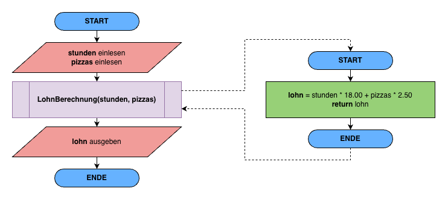

# Methoden (2/3)

## Lernziel
Am Ende dieser Lektion schreibst du Methoden mit Rückgabewert, verwendest das Ergebnis weiter, prüfst mit `bool`-Methoden und lagerst Code durch Refactoring in Methoden aus.

---

## 1. Einstieg

- Bisher haben deine Methoden etwas ausgegeben. Oft brauchst du aber das Ergebnis weiter: für eine Berechnung, eine Bedingung oder eine Anzeige an anderer Stelle. Dafür gibt eine Methode einen Wert zurück.
- Methoden mit Rückgabewert sind die Bausteine für Berechnungen, Prüfungen und Umrechnungen. Du kennst sie bereits von Hilfsfunktionen wie `Math.Max(a, b)`.
- Refactoring heisst: Code umbauen, ohne dass sich das Verhalten ändert. Das Ziel ist ein Programm, das du auch in drei Monaten noch verstehst.

---

## 2. Grundlagen

### A - Rückgabewert und return

```csharp
int ergebnis = Quadrat(5);
Console.WriteLine(ergebnis);   // 25

int Quadrat(int zahl)
{
    return zahl * zahl;
}
```

- Statt `void` steht der Datentyp des Ergebnisses vor dem Methodennamen.
- `return` liefert den Wert zurück und beendet die Methode sofort.
- Der Datentyp des Werts bei `return` muss zum Datentyp der Methode passen.

### B - Den Rückgabewert weiterverwenden

Ein Methodenaufruf mit Rückgabewert ist ein Wert. Du kannst ihn überall einsetzen, wo auch eine Zahl oder Variable stehen darf:

```csharp
int a = Addiere(2, 3);
Console.WriteLine(Addiere(a, 1) * 2);
if (Addiere(a, 1) > 5)
{
    Console.WriteLine("gross");
}
```

Ein Aufruf wie `Quadrat(5);` ohne Variable kompiliert zwar, das Ergebnis geht aber verloren.

### C - bool-Methoden

```csharp
bool IstGerade(int zahl)
{
    return zahl % 2 == 0;
}

if (IstGerade(4))
{
    Console.WriteLine("gerade");
}
```

Namen wie `IstGerade`, `IstPrimzahl` oder `HatGenug` lesen sich in der `if`-Bedingung wie ein Satz.

### D - Jeder Weg braucht ein return

```csharp
int Groesste(int a, int b)
{
    if (a > b)
        return a;
    else if (b > a)
        return b;
}
```

Das ergibt den Fehler CS0161 ("not all code paths return a value"). Für `a == b` gibt es keinen `return`. Der Compiler prüft alle möglichen Wege durch die Methode.

### E - PAP einer Methode mit Rückgabe

Der PAP der Methode beginnt bei ihrem Namen. Jeder Weg endet in einem Ergebnis ("gib zurück"). Eine Methode kann mehrere Enden haben, solange jeder Weg eines hat.



### F - Refactoring

Wenn ein Programm lang wird, lagerst du zusammengehörende Blöcke in Methoden aus:

1. Block markieren, der eine Sache macht.
2. Passenden Namen wählen.
3. Was geht hinein? Das werden die Parameter.
4. Was kommt heraus? Das wird der Rückgabewert.
5. Block verschieben, Aufruf einsetzen und testen. Das Programm muss sich danach gleich verhalten.

### G - Eingabe als Methode

```csharp
int alter = LeseZahl("Alter", 0, 120);

int LeseZahl(string frage, int min, int max)
{
    int zahl;
    do
    {
        Console.Write(frage + " [" + min + "-" + max + "]: ");
        zahl = Convert.ToInt32(Console.ReadLine());
    }
    while (zahl < min || zahl > max);
    return zahl;
}
```

---

## 3. Übungen

**Regeln**: Die offizielle C#-Dokumentation und Ressourcen im Netz darfst du verwenden. KI-Tools bleiben weg, damit der Lerneffekt möglichst gross ist.

### 1. Code lesen III
Was gibt das Programm aus?

```csharp
int a = Addiere(2, 3);
int b = Addiere(a, a);
Console.WriteLine(b);
Console.WriteLine(Addiere(b, 1) * 2);
Addiere(100, 200);
Console.WriteLine(IstGerade(b));

int Addiere(int x, int y)
{
    return x + y;
}

bool IstGerade(int zahl)
{
    return zahl % 2 == 0;
}
```

---

### 2. Fehler finden III
Das Programm soll das Quadrat von 5 und die grössere von zwei Zahlen ausgeben. Es enthält einen **Kompilierfehler** und einen **Denkfehler im Hauptprogramm** (der Code läuft, tut aber nicht, was er soll). Finde beide, erkläre sie und korrigiere sie.

```csharp
01  Quadrat(5);
02  Console.WriteLine(Groesste(4, 7));
03
04  int Quadrat(int zahl)
05  {
06      return zahl * zahl;
07  }
08
09  int Groesste(int a, int b)
10  {
11      if (a > b)
12          return a;
13      else if (b > a)
14          return b;
15  }
```

---

### 3. Methoden schreiben
Schreibe folgende Methoden und rufe jede im Hauptprogramm mit mindestens zwei Testwerten auf:

a) `int Maximum(int a, int b)` gibt die grössere der beiden Zahlen zurück.
b) `bool IstGerade(int zahl)` gibt `true` zurück, wenn die Zahl gerade ist.
c) `long Fakultaet(int n)` berechnet n! (Beispiel: `Fakultaet(5)` ist 120). Verwende den Datentyp `long`.
d) `long Potenz(int basis, int exponent)` berechnet die Potenz mit einer Schleife (Beispiel: `Potenz(2, 10)` ist 1024). Die Methode `Math.Pow` ist hier nicht erlaubt.
e) **Zusatz:** `bool IstPrimzahl(int zahl)`. Testwerte: 1 (nein), 2 (ja), 17 (ja), 21 (nein), 97 (ja).

---

### 4. PAP Maximum
Zeichne den PAP der Methode `Maximum(a, b)` aus Aufgabe 3a. Markiere die Stellen, an denen ein Wert zurückgegeben wird.

---

### 5. Ringen 🤼
Beim Ringen werden Sportler in Gewichtsklassen eingeteilt:

| | Männer | Frauen |
|---|---|---|
| Fliegengewicht | bis 55 kg | bis 48 kg |
| Leichtgewicht | bis 66 kg | bis 55 kg |
| Mittelgewicht | bis 84 kg | bis 63 kg |
| Schwergewicht | darüber | darüber |

Schreibe eine Methode `string Gewichtsklasse(string geschlecht, double gewicht)`, die die Klasse als Text zurückgibt. Das Hauptprogramm liest Geschlecht (`m` oder `w`) und Gewicht ein und gibt die Klasse aus. Beispiel: `m` und `75` ergibt `Mittelgewicht`.

### 6. LeseZahl
Schreibe eine Methode `int LeseZahl(string frage, int min, int max)`. Sie fragt so lange nach einer Zahl, bis diese zwischen `min` und `max` liegt, und gibt sie dann zurück. Bei einer ungültigen Eingabe erscheint eine Meldung. Teste sie im Hauptprogramm für ein Alter (0 bis 120) und einen Tag (1 bis 31).

### 7. Wochentag (Zusatz) 📅
Schreibe eine Methode `string Wochentag(int tag, int monat, int jahr)`, die den Wochentag als Text zurückgibt (Gib den Text mit einer `switch`-Anweisung mit `return` zurück). Verwende diese Berechnung:

```csharp
int[] offset = { 0, 3, 2, 5, 0, 3, 5, 1, 4, 6, 2, 4 };
if (monat < 3) jahr = jahr - 1;
int nr = (jahr + jahr / 4 - jahr / 100 + jahr / 400 + offset[monat - 1] + tag) % 7;
```

`nr` ist 0 für Sonntag, 1 für Montag und so weiter bis 6 für Samstag. Beispiel: 25.10.2021 ergibt Montag. Überlege: Warum bleiben `tag`, `monat` und `jahr` im Hauptprogramm unverändert, obwohl die Methode `jahr` ändert?

## 4. Weiterführende Beispiele und Gedanken

- Typische Stolperfalle: Der Rückgabewert wird nicht aufgefangen (`Quadrat(5);`). Es passiert nichts Sichtbares.
- Typische Stolperfalle: Ein Weg ohne `return` (Fehler CS0161). Zeichne den PAP, dann siehst du den fehlenden Weg.
- Faustregel: Eine Methode macht eine Sache. Wenn dein Methodenname ein "und" enthält, sind es meist zwei Methoden.
- Überlege: Welche Methoden aus der Standardbibliothek kennst du bereits, die einen Wert zurückgeben? (`Math.Max`, `Convert.ToInt32`, `Console.ReadLine`)
- Weiterführend: Offizielle Dokumentation zur `return`-Anweisung: [https://learn.microsoft.com/de-de/dotnet/csharp/language-reference/statements/jump-statements](https://learn.microsoft.com/de-de/dotnet/csharp/language-reference/statements/jump-statements)
